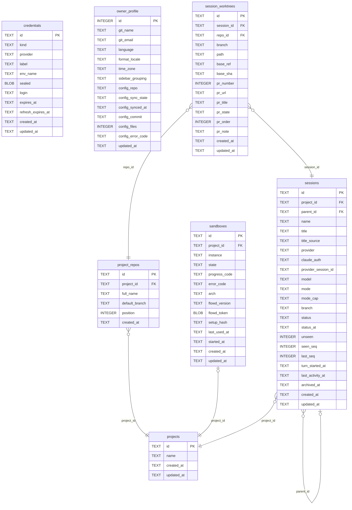

<!-- Generated by github.com/trick77/ship/kit/schemadoc, do not edit. Regenerate in the Go module directory: SCHEMADOC_UPDATE=1 go test ./... -run TestSchemaDoc -->

# Database schema

7 tables; the diagram is at the end. Go types are the `model.go` structs whose rows they hold.

## credentials

Go types:

- `credentials.Credential` (internal/credentials): Credential is one stored secret: the GitHub App user tokens or an API key. Sealed holds the secret material encrypted by a Sealer; nothing else in the row is secret.

| Column | Type | Null | Default | PK |
| --- | --- | --- | --- | --- |
| `id` | TEXT | no |  | 1 |
| `kind` | TEXT | no |  |  |
| `provider` | TEXT | no | `''` |  |
| `label` | TEXT | no | `''` |  |
| `env_name` | TEXT | no | `''` |  |
| `sealed` | BLOB | no |  |  |
| `login` | TEXT | no | `''` |  |
| `expires_at` | TEXT | yes |  |  |
| `refresh_expires_at` | TEXT | yes |  |  |
| `created_at` | TEXT | no | `strftime('%Y-%m-%dT%H:%M:%fZ', 'now')` |  |
| `updated_at` | TEXT | no | `strftime('%Y-%m-%dT%H:%M:%fZ', 'now')` |  |

Indexes:

- `sqlite_autoindex_credentials_2` (`kind`, `provider`) unique

Checks:

- `CHECK (kind IN ('github', 'claude_token', 'anthropic', 'opencode_provider'))`

## owner_profile

Go types:

- `profile.Profile` (internal/profile): Profile is the owner's profile and settings, the one row of its table.

| Column | Type | Null | Default | PK |
| --- | --- | --- | --- | --- |
| `id` | INTEGER | no |  | 1 |
| `git_name` | TEXT | no | `''` |  |
| `git_email` | TEXT | no | `''` |  |
| `language` | TEXT | no | `'en'` |  |
| `format_locale` | TEXT | no | `'en-CH'` |  |
| `time_zone` | TEXT | no | `'Europe/Zurich'` |  |
| `sidebar_grouping` | TEXT | no | `'status'` |  |
| `config_repo` | TEXT | no | `''` |  |
| `config_sync_state` | TEXT | no | `'never'` |  |
| `config_synced_at` | TEXT | yes |  |  |
| `config_commit` | TEXT | no | `''` |  |
| `config_files` | INTEGER | no | `0` |  |
| `config_error_code` | TEXT | no | `''` |  |
| `updated_at` | TEXT | no | `strftime('%Y-%m-%dT%H:%M:%fZ', 'now')` |  |

Checks:

- `CHECK (id = 1)`
- `CHECK (sidebar_grouping IN ('status', 'project'))`
- `CHECK (config_sync_state IN ('never', 'syncing', 'synced', 'failed'))`

## project_repos

Go types:

- `projects.Repo` (internal/projects): Repo is one repository of a project.

| Column | Type | Null | Default | PK |
| --- | --- | --- | --- | --- |
| `id` | TEXT | no |  | 1 |
| `project_id` | TEXT | no |  |  |
| `full_name` | TEXT | no |  |  |
| `default_branch` | TEXT | no |  |  |
| `position` | INTEGER | no | `0` |  |
| `created_at` | TEXT | no | `strftime('%Y-%m-%dT%H:%M:%fZ', 'now')` |  |

Foreign keys:

- `project_id` → `projects` (`id`), on delete CASCADE

Indexes:

- `sqlite_autoindex_project_repos_2` (`project_id`, `full_name`) unique

## projects

Go types:

- `projects.Project` (internal/projects): Project is a named group of GitHub repositories with one sandbox.

| Column | Type | Null | Default | PK |
| --- | --- | --- | --- | --- |
| `id` | TEXT | no |  | 1 |
| `name` | TEXT | no |  |  |
| `created_at` | TEXT | no | `strftime('%Y-%m-%dT%H:%M:%fZ', 'now')` |  |
| `updated_at` | TEXT | no | `strftime('%Y-%m-%dT%H:%M:%fZ', 'now')` |  |

Indexes:

- `sqlite_autoindex_projects_2` (`name`) unique

## sandboxes

Go types:

- `sandboxes.Sandbox` (internal/sandboxes): Sandbox is the one sandbox of a project as Flow last saw it; Incus holds the truth about the instance.

| Column | Type | Null | Default | PK |
| --- | --- | --- | --- | --- |
| `id` | TEXT | no |  | 1 |
| `project_id` | TEXT | no |  |  |
| `instance` | TEXT | no |  |  |
| `state` | TEXT | no | `'none'` |  |
| `progress_code` | TEXT | no | `''` |  |
| `error_code` | TEXT | no | `''` |  |
| `arch` | TEXT | no | `''` |  |
| `flowd_version` | TEXT | no | `''` |  |
| `flowd_token` | BLOB | yes |  |  |
| `setup_hash` | TEXT | no | `''` |  |
| `last_used_at` | TEXT | yes |  |  |
| `started_at` | TEXT | yes |  |  |
| `created_at` | TEXT | no | `strftime('%Y-%m-%dT%H:%M:%fZ', 'now')` |  |
| `updated_at` | TEXT | no | `strftime('%Y-%m-%dT%H:%M:%fZ', 'now')` |  |

Foreign keys:

- `project_id` → `projects` (`id`), on delete CASCADE

Indexes:

- `sqlite_autoindex_sandboxes_2` (`project_id`) unique
- `sqlite_autoindex_sandboxes_3` (`instance`) unique

Checks:

- `CHECK (state IN ('none', 'setup', 'warm', 'stopping', 'stopped', 'failed', 'deleting'))`

## session_worktrees

Go types:

- `sessions.Worktree` (internal/sessions): Worktree is one repository of a session, on the session's branch, with its pull request.

| Column | Type | Null | Default | PK |
| --- | --- | --- | --- | --- |
| `id` | TEXT | no |  | 1 |
| `session_id` | TEXT | no |  |  |
| `repo_id` | TEXT | no |  |  |
| `branch` | TEXT | no |  |  |
| `path` | TEXT | no |  |  |
| `base_ref` | TEXT | no |  |  |
| `base_sha` | TEXT | no | `''` |  |
| `pr_number` | INTEGER | no | `0` |  |
| `pr_url` | TEXT | no | `''` |  |
| `pr_title` | TEXT | no | `''` |  |
| `pr_state` | TEXT | no | `'not_opened'` |  |
| `pr_order` | INTEGER | no | `0` |  |
| `pr_note` | TEXT | no | `''` |  |
| `created_at` | TEXT | no | `strftime('%Y-%m-%dT%H:%M:%fZ', 'now')` |  |
| `updated_at` | TEXT | no | `strftime('%Y-%m-%dT%H:%M:%fZ', 'now')` |  |

Foreign keys:

- `repo_id` → `project_repos` (`id`), on delete RESTRICT
- `session_id` → `sessions` (`id`), on delete CASCADE

Indexes:

- `session_worktrees_repo` (`repo_id`)
- `sqlite_autoindex_session_worktrees_2` (`session_id`, `repo_id`) unique

Checks:

- `CHECK (pr_state IN ('not_opened', 'draft', 'open', 'merged', 'closed'))`

## sessions

Go types:

- `sessions.Session` (internal/sessions): Session is what Flow keeps of a session: the sidebar's fields and how far Flow has followed its log.

| Column | Type | Null | Default | PK |
| --- | --- | --- | --- | --- |
| `id` | TEXT | no |  | 1 |
| `project_id` | TEXT | no |  |  |
| `parent_id` | TEXT | yes |  |  |
| `name` | TEXT | no |  |  |
| `title` | TEXT | no | `''` |  |
| `title_source` | TEXT | no | `'derived'` |  |
| `provider` | TEXT | no |  |  |
| `claude_auth` | TEXT | no | `''` |  |
| `provider_session_id` | TEXT | no | `''` |  |
| `model` | TEXT | no |  |  |
| `mode` | TEXT | no |  |  |
| `mode_cap` | TEXT | no | `''` |  |
| `branch` | TEXT | no |  |  |
| `status` | TEXT | no | `'idle'` |  |
| `status_at` | TEXT | no | `strftime('%Y-%m-%dT%H:%M:%fZ', 'now')` |  |
| `unseen` | INTEGER | no | `0` |  |
| `seen_seq` | INTEGER | no | `0` |  |
| `last_seq` | INTEGER | no | `0` |  |
| `turn_started_at` | TEXT | yes |  |  |
| `last_activity_at` | TEXT | no | `strftime('%Y-%m-%dT%H:%M:%fZ', 'now')` |  |
| `archived_at` | TEXT | yes |  |  |
| `created_at` | TEXT | no | `strftime('%Y-%m-%dT%H:%M:%fZ', 'now')` |  |
| `updated_at` | TEXT | no | `strftime('%Y-%m-%dT%H:%M:%fZ', 'now')` |  |

Foreign keys:

- `parent_id` → `sessions` (`id`), on delete SET NULL
- `project_id` → `projects` (`id`), on delete CASCADE

Indexes:

- `sessions_parent` (`parent_id`)
- `sessions_sidebar` (`archived_at`, `last_activity_at`)
- `sqlite_autoindex_sessions_2` (`project_id`, `name`) unique

Checks:

- `CHECK (title_source IN ('owner', 'helper', 'derived', 'parent'))`
- `CHECK (provider IN ('claude', 'opencode'))`
- `CHECK (claude_auth IN ('', 'subscription_token', 'subscription_login', 'api_key'))`
- `CHECK (mode IN ('plan', 'ask', 'accept_edits', 'auto', 'full_access'))`
- `CHECK (mode_cap IN ('', 'plan', 'ask', 'accept_edits', 'auto', 'full_access'))`
- `CHECK (status IN ('idle', 'working', 'queued', 'approval', 'plan', 'question', 'done', 'failed'))`
- `CHECK (unseen IN (0, 1))`

## Diagram

