<!-- Generated by github.com/trick77/ship/kit/schemadoc, do not edit. Regenerate in the Go module directory: SCHEMADOC_UPDATE=1 go test ./... -run TestSchemaDoc -->

# Database schema

19 tables; the diagram is at the end. Go types are the `model.go` structs whose rows they hold.

## credentials

Go types:

- `credentials.Credential` (internal/credentials): Credential is one stored secret: the GitHub App user tokens or an API key. Sealed holds the secret material encrypted by a Sealer; nothing else in the row is secret.

| Column | Type | Null | Default | PK |
| --- | --- | --- | --- | --- |
| `id` | TEXT | no |  | 1 |
| `kind` | TEXT | no |  |  |
| `provider` | TEXT | no | `''` |  |
| `label` | TEXT | no | `''` |  |
| `env_name` | TEXT | no | `''` |  |
| `sealed` | BLOB | no |  |  |
| `login` | TEXT | no | `''` |  |
| `expires_at` | TEXT | yes |  |  |
| `refresh_expires_at` | TEXT | yes |  |  |
| `created_at` | TEXT | no | `strftime('%Y-%m-%dT%H:%M:%fZ', 'now')` |  |
| `updated_at` | TEXT | no | `strftime('%Y-%m-%dT%H:%M:%fZ', 'now')` |  |

Indexes:

- `sqlite_autoindex_credentials_2` (`kind`, `provider`) unique

Checks:

- `CHECK (kind IN ('github', 'claude_token', 'anthropic', 'opencode_provider'))`

## metering_check_runs

Go types:

- `metering.CheckRun` (internal/metering): CheckRun is one run of the gate for a session's repository.

| Column | Type | Null | Default | PK |
| --- | --- | --- | --- | --- |
| `id` | TEXT | no |  | 1 |
| `session_id` | TEXT | no |  |  |
| `project_id` | TEXT | no |  |  |
| `repo` | TEXT | no |  |  |
| `started_at` | TEXT | no |  |  |
| `duration_ms` | INTEGER | no |  |  |
| `queue_wait_ms` | INTEGER | no | `0` |  |
| `result` | TEXT | no |  |  |
| `exit_code` | INTEGER | yes |  |  |
| `failing_step` | TEXT | no | `''` |  |
| `recorded_at` | TEXT | no | `strftime('%Y-%m-%dT%H:%M:%fZ', 'now')` |  |

Checks:

- `CHECK (result IN ('passed', 'failed', 'error', 'cancelled'))`

## metering_counters

Go types:

- `metering.Counter` (internal/metering): Counter is one occurrence of a reliability event (Count > 1 only for a batch).

| Column | Type | Null | Default | PK |
| --- | --- | --- | --- | --- |
| `id` | TEXT | no |  | 1 |
| `counter` | TEXT | no |  |  |
| `class` | TEXT | no | `''` |  |
| `session_id` | TEXT | yes |  |  |
| `project_id` | TEXT | no | `''` |  |
| `seq` | INTEGER | yes |  |  |
| `at` | TEXT | no |  |  |
| `count` | INTEGER | no | `1` |  |
| `recorded_at` | TEXT | no | `strftime('%Y-%m-%dT%H:%M:%fZ', 'now')` |  |

Indexes:

- `metering_counters_time` (`counter`, `at`)
- `sqlite_autoindex_metering_counters_2` (`session_id`, `seq`, `counter`) unique

Checks:

- `CHECK (counter IN ('turn_error', 'turn_lost', 'provider_error', 'passthrough', 'unknown_kind', 'flowd_restart', 'flow_restart', 'reconnect', 'credential_renewal_failure'))`

## metering_file_changes

Go types:

- `metering.FileChange` (internal/metering): FileChange is what a turn changed in one repository, as counts.

| Column | Type | Null | Default | PK |
| --- | --- | --- | --- | --- |
| `id` | TEXT | no |  | 1 |
| `session_id` | TEXT | no |  |  |
| `project_id` | TEXT | no |  |  |
| `seq` | INTEGER | no |  |  |
| `turn` | TEXT | no | `''` |  |
| `repo` | TEXT | no |  |  |
| `files` | INTEGER | no |  |  |
| `lines_added` | INTEGER | no |  |  |
| `lines_removed` | INTEGER | no |  |  |
| `at` | TEXT | no |  |  |
| `recorded_at` | TEXT | no | `strftime('%Y-%m-%dT%H:%M:%fZ', 'now')` |  |

Indexes:

- `sqlite_autoindex_metering_file_changes_2` (`session_id`, `seq`) unique

## metering_helper_calls

Go types:

- `metering.HelperCall` (internal/metering): HelperCall is one of the backend's own model calls (titles, branch names, summaries, commit and PR text).

| Column | Type | Null | Default | PK |
| --- | --- | --- | --- | --- |
| `id` | TEXT | no |  | 1 |
| `task` | TEXT | no |  |  |
| `session_id` | TEXT | yes |  |  |
| `project_id` | TEXT | no | `''` |  |
| `provider` | TEXT | no |  |  |
| `model` | TEXT | no |  |  |
| `started_at` | TEXT | no |  |  |
| `duration_ms` | INTEGER | no |  |  |
| `input_tokens` | INTEGER | no | `0` |  |
| `output_tokens` | INTEGER | no | `0` |  |
| `cost_usd` | REAL | yes |  |  |
| `outcome` | TEXT | no |  |  |
| `error_class` | TEXT | no | `''` |  |
| `recorded_at` | TEXT | no | `strftime('%Y-%m-%dT%H:%M:%fZ', 'now')` |  |

Checks:

- `CHECK (outcome IN ('ok', 'error'))`

## metering_permission_decisions

Go types:

- `metering.PermissionDecision` (internal/metering): PermissionDecision is the decision on a permission request, with the request's facts copied in.

| Column | Type | Null | Default | PK |
| --- | --- | --- | --- | --- |
| `id` | TEXT | no |  | 1 |
| `session_id` | TEXT | no |  |  |
| `project_id` | TEXT | no |  |  |
| `seq` | INTEGER | no |  |  |
| `request_id` | TEXT | no |  |  |
| `tool` | TEXT | no | `''` |  |
| `kind` | TEXT | no | `''` |  |
| `decision` | TEXT | no |  |  |
| `requested_at` | TEXT | yes |  |  |
| `decided_at` | TEXT | no |  |  |
| `wait_ms` | INTEGER | yes |  |  |
| `recorded_at` | TEXT | no | `strftime('%Y-%m-%dT%H:%M:%fZ', 'now')` |  |

Indexes:

- `sqlite_autoindex_metering_permission_decisions_2` (`session_id`, `seq`) unique

## metering_permission_requests

Go types:

- `metering.PermissionRequest` (internal/metering): PermissionRequest is a permission request as asked: the tool and its permission class, never what it would run.

| Column | Type | Null | Default | PK |
| --- | --- | --- | --- | --- |
| `id` | TEXT | no |  | 1 |
| `session_id` | TEXT | no |  |  |
| `project_id` | TEXT | no |  |  |
| `seq` | INTEGER | no |  |  |
| `request_id` | TEXT | no |  |  |
| `tool` | TEXT | no |  |  |
| `kind` | TEXT | no |  |  |
| `mode` | TEXT | no | `''` |  |
| `requested_at` | TEXT | no |  |  |
| `recorded_at` | TEXT | no | `strftime('%Y-%m-%dT%H:%M:%fZ', 'now')` |  |

Indexes:

- `metering_permission_requests_request` (`session_id`, `request_id`)
- `sqlite_autoindex_metering_permission_requests_2` (`session_id`, `seq`) unique

## metering_pull_requests

Go types:

- `metering.PullRequest` (internal/metering): PullRequest is one state change of a session's pull request: every open, close, reopen and merge is a row.

| Column | Type | Null | Default | PK |
| --- | --- | --- | --- | --- |
| `id` | TEXT | no |  | 1 |
| `session_id` | TEXT | no |  |  |
| `project_id` | TEXT | no |  |  |
| `repo` | TEXT | no |  |  |
| `number` | INTEGER | no |  |  |
| `action` | TEXT | no |  |  |
| `seq` | INTEGER | yes |  |  |
| `at` | TEXT | no |  |  |
| `recorded_at` | TEXT | no | `strftime('%Y-%m-%dT%H:%M:%fZ', 'now')` |  |

Indexes:

- `sqlite_autoindex_metering_pull_requests_2` (`session_id`, `seq`, `repo`, `number`) unique

Checks:

- `CHECK (action IN ('opened', 'reopened', 'merged', 'closed'))`

## metering_sandbox_samples

Go types:

- `metering.SandboxSample` (internal/metering): SandboxSample is a coarse sample of a sandbox, or of one session's unit in it. The counters (CPU, pressure-stall totals, OOM kills) are cumulative since the unit started, as the kernel reports them.

| Column | Type | Null | Default | PK |
| --- | --- | --- | --- | --- |
| `id` | TEXT | no |  | 1 |
| `sandbox_id` | TEXT | no |  |  |
| `project_id` | TEXT | no |  |  |
| `session_id` | TEXT | yes |  |  |
| `at` | TEXT | no |  |  |
| `state` | TEXT | no |  |  |
| `memory_bytes` | INTEGER | no | `0` |  |
| `swap_bytes` | INTEGER | no | `0` |  |
| `disk_bytes` | INTEGER | no | `0` |  |
| `cpu_usec` | INTEGER | no | `0` |  |
| `psi_cpu_some_us` | INTEGER | no | `0` |  |
| `psi_mem_some_us` | INTEGER | no | `0` |  |
| `psi_mem_full_us` | INTEGER | no | `0` |  |
| `psi_io_some_us` | INTEGER | no | `0` |  |
| `psi_io_full_us` | INTEGER | no | `0` |  |
| `oom_kills` | INTEGER | no | `0` |  |
| `recorded_at` | TEXT | no | `strftime('%Y-%m-%dT%H:%M:%fZ', 'now')` |  |

Indexes:

- `metering_sandbox_samples_time` (`sandbox_id`, `at`)

## metering_status_changes

Go types:

- `metering.StatusChange` (internal/metering): StatusChange is one session status transition: FromStatus held from FromAt until At.

| Column | Type | Null | Default | PK |
| --- | --- | --- | --- | --- |
| `id` | TEXT | no |  | 1 |
| `session_id` | TEXT | no |  |  |
| `project_id` | TEXT | no |  |  |
| `seq` | INTEGER | no |  |  |
| `from_status` | TEXT | no | `''` |  |
| `from_at` | TEXT | yes |  |  |
| `to_status` | TEXT | no |  |  |
| `at` | TEXT | no |  |  |
| `recorded_at` | TEXT | no | `strftime('%Y-%m-%dT%H:%M:%fZ', 'now')` |  |

Indexes:

- `sqlite_autoindex_metering_status_changes_2` (`session_id`, `seq`) unique

## metering_turn_starts

Go types:

- `metering.TurnStart` (internal/metering): TurnStart is a turn as it started: the provider and model it runs on, fixed then so a model change during the turn does not move it.

| Column | Type | Null | Default | PK |
| --- | --- | --- | --- | --- |
| `id` | TEXT | no |  | 1 |
| `session_id` | TEXT | no |  |  |
| `project_id` | TEXT | no |  |  |
| `seq` | INTEGER | no |  |  |
| `turn` | TEXT | no |  |  |
| `provider` | TEXT | no | `''` |  |
| `model` | TEXT | no | `''` |  |
| `at` | TEXT | no |  |  |
| `recorded_at` | TEXT | no | `strftime('%Y-%m-%dT%H:%M:%fZ', 'now')` |  |

Indexes:

- `metering_turn_starts_turn` (`session_id`, `turn`)
- `sqlite_autoindex_metering_turn_starts_2` (`session_id`, `seq`) unique

## metering_turns

Go types:

- `metering.Turn` (internal/metering): Turn is one ended turn of a session: who ran it on what, how long, and what it used.

| Column | Type | Null | Default | PK |
| --- | --- | --- | --- | --- |
| `id` | TEXT | no |  | 1 |
| `session_id` | TEXT | no |  |  |
| `project_id` | TEXT | no |  |  |
| `parent_session_id` | TEXT | yes |  |  |
| `seq` | INTEGER | no |  |  |
| `turn` | TEXT | no | `''` |  |
| `repos` | TEXT | no | `'[]'` |  |
| `provider` | TEXT | no |  |  |
| `model` | TEXT | no | `''` |  |
| `credential_mode` | TEXT | no | `''` |  |
| `started_at` | TEXT | no |  |  |
| `ended_at` | TEXT | no |  |  |
| `duration_ms` | INTEGER | no |  |  |
| `outcome` | TEXT | no |  |  |
| `error_code` | TEXT | no | `''` |  |
| `input_tokens` | INTEGER | no | `0` |  |
| `output_tokens` | INTEGER | no | `0` |  |
| `cache_read_tokens` | INTEGER | no | `0` |  |
| `cache_write_tokens` | INTEGER | no | `0` |  |
| `cost_usd` | REAL | yes |  |  |
| `api_equivalent_usd` | REAL | yes |  |  |
| `recorded_at` | TEXT | no | `strftime('%Y-%m-%dT%H:%M:%fZ', 'now')` |  |

Indexes:

- `metering_turns_time` (`started_at`)
- `sqlite_autoindex_metering_turns_2` (`session_id`, `seq`) unique

## metering_waits

Go types:

- `metering.Wait` (internal/metering): Wait is a bottleneck: something waited for a resource from StartedAt to EndedAt.

| Column | Type | Null | Default | PK |
| --- | --- | --- | --- | --- |
| `id` | TEXT | no |  | 1 |
| `session_id` | TEXT | yes |  |  |
| `project_id` | TEXT | no | `''` |  |
| `reason` | TEXT | no |  |  |
| `started_at` | TEXT | no |  |  |
| `ended_at` | TEXT | no |  |  |
| `duration_ms` | INTEGER | no |  |  |
| `resource` | TEXT | no | `''` |  |
| `position` | INTEGER | yes |  |  |
| `holder_session_id` | TEXT | yes |  |  |
| `holder_repo` | TEXT | no | `''` |  |
| `seq` | INTEGER | yes |  |  |
| `recorded_at` | TEXT | no | `strftime('%Y-%m-%dT%H:%M:%fZ', 'now')` |  |

Indexes:

- `metering_waits_time` (`reason`, `started_at`)
- `sqlite_autoindex_metering_waits_2` (`session_id`, `seq`, `reason`) unique

Checks:

- `CHECK (reason IN ('check_queue', 'sandbox_start', 'sandbox_resume', 'owner_approval', 'owner_question', 'owner_plan', 'rate_limit', 'provider_retry', 'started_sessions', 'credential_renewal'))`

## owner_profile

Go types:

- `profile.Profile` (internal/profile): Profile is the owner's profile and settings, the one row of its table.

| Column | Type | Null | Default | PK |
| --- | --- | --- | --- | --- |
| `id` | INTEGER | no |  | 1 |
| `git_name` | TEXT | no | `''` |  |
| `git_email` | TEXT | no | `''` |  |
| `language` | TEXT | no | `'en'` |  |
| `format_locale` | TEXT | no | `'en-CH'` |  |
| `time_zone` | TEXT | no | `'Europe/Zurich'` |  |
| `sidebar_grouping` | TEXT | no | `'status'` |  |
| `config_repo` | TEXT | no | `''` |  |
| `config_sync_state` | TEXT | no | `'never'` |  |
| `config_synced_at` | TEXT | yes |  |  |
| `config_commit` | TEXT | no | `''` |  |
| `config_files` | INTEGER | no | `0` |  |
| `config_error_code` | TEXT | no | `''` |  |
| `updated_at` | TEXT | no | `strftime('%Y-%m-%dT%H:%M:%fZ', 'now')` |  |

Checks:

- `CHECK (id = 1)`
- `CHECK (sidebar_grouping IN ('status', 'project'))`
- `CHECK (config_sync_state IN ('never', 'syncing', 'synced', 'failed'))`

## project_repos

Go types:

- `projects.Repo` (internal/projects): Repo is one repository of a project.

| Column | Type | Null | Default | PK |
| --- | --- | --- | --- | --- |
| `id` | TEXT | no |  | 1 |
| `project_id` | TEXT | no |  |  |
| `full_name` | TEXT | no |  |  |
| `default_branch` | TEXT | no |  |  |
| `position` | INTEGER | no | `0` |  |
| `created_at` | TEXT | no | `strftime('%Y-%m-%dT%H:%M:%fZ', 'now')` |  |

Foreign keys:

- `project_id` → `projects` (`id`), on delete CASCADE

Indexes:

- `sqlite_autoindex_project_repos_2` (`project_id`, `full_name`) unique

## projects

Go types:

- `projects.Project` (internal/projects): Project is a named group of GitHub repositories with one sandbox.

| Column | Type | Null | Default | PK |
| --- | --- | --- | --- | --- |
| `id` | TEXT | no |  | 1 |
| `name` | TEXT | no |  |  |
| `created_at` | TEXT | no | `strftime('%Y-%m-%dT%H:%M:%fZ', 'now')` |  |
| `updated_at` | TEXT | no | `strftime('%Y-%m-%dT%H:%M:%fZ', 'now')` |  |

Indexes:

- `sqlite_autoindex_projects_2` (`name`) unique

## sandboxes

Go types:

- `sandboxes.Sandbox` (internal/sandboxes): Sandbox is the one sandbox of a project as Flow last saw it; Incus holds the truth about the instance.

| Column | Type | Null | Default | PK |
| --- | --- | --- | --- | --- |
| `id` | TEXT | no |  | 1 |
| `project_id` | TEXT | no |  |  |
| `instance` | TEXT | no |  |  |
| `state` | TEXT | no | `'none'` |  |
| `progress_code` | TEXT | no | `''` |  |
| `error_code` | TEXT | no | `''` |  |
| `arch` | TEXT | no | `''` |  |
| `flowd_version` | TEXT | no | `''` |  |
| `flowd_token` | BLOB | yes |  |  |
| `setup_hash` | TEXT | no | `''` |  |
| `last_used_at` | TEXT | yes |  |  |
| `started_at` | TEXT | yes |  |  |
| `created_at` | TEXT | no | `strftime('%Y-%m-%dT%H:%M:%fZ', 'now')` |  |
| `updated_at` | TEXT | no | `strftime('%Y-%m-%dT%H:%M:%fZ', 'now')` |  |
| `ipv4` | TEXT | yes |  |  |

Foreign keys:

- `project_id` → `projects` (`id`), on delete CASCADE

Indexes:

- `sandboxes_ipv4` (`ipv4`) unique
- `sqlite_autoindex_sandboxes_2` (`project_id`) unique
- `sqlite_autoindex_sandboxes_3` (`instance`) unique

Checks:

- `CHECK (state IN ('none', 'setup', 'warm', 'stopping', 'stopped', 'failed', 'deleting'))`

## session_worktrees

Go types:

- `sessions.Worktree` (internal/sessions): Worktree is one repository of a session, on the session's branch, with its pull request.

| Column | Type | Null | Default | PK |
| --- | --- | --- | --- | --- |
| `id` | TEXT | no |  | 1 |
| `session_id` | TEXT | no |  |  |
| `repo_id` | TEXT | no |  |  |
| `branch` | TEXT | no |  |  |
| `path` | TEXT | no |  |  |
| `base_ref` | TEXT | no |  |  |
| `base_sha` | TEXT | no | `''` |  |
| `pr_number` | INTEGER | no | `0` |  |
| `pr_url` | TEXT | no | `''` |  |
| `pr_title` | TEXT | no | `''` |  |
| `pr_state` | TEXT | no | `'not_opened'` |  |
| `pr_order` | INTEGER | no | `0` |  |
| `pr_note` | TEXT | no | `''` |  |
| `created_at` | TEXT | no | `strftime('%Y-%m-%dT%H:%M:%fZ', 'now')` |  |
| `updated_at` | TEXT | no | `strftime('%Y-%m-%dT%H:%M:%fZ', 'now')` |  |

Foreign keys:

- `repo_id` → `project_repos` (`id`), on delete RESTRICT
- `session_id` → `sessions` (`id`), on delete CASCADE

Indexes:

- `session_worktrees_repo` (`repo_id`)
- `sqlite_autoindex_session_worktrees_2` (`session_id`, `repo_id`) unique

Checks:

- `CHECK (pr_state IN ('not_opened', 'draft', 'open', 'merged', 'closed'))`

## sessions

Go types:

- `sessions.Session` (internal/sessions): Session is what Flow keeps of a session: the sidebar's fields and how far Flow has followed its log.

| Column | Type | Null | Default | PK |
| --- | --- | --- | --- | --- |
| `id` | TEXT | no |  | 1 |
| `project_id` | TEXT | no |  |  |
| `parent_id` | TEXT | yes |  |  |
| `name` | TEXT | no |  |  |
| `title` | TEXT | no | `''` |  |
| `title_source` | TEXT | no | `'derived'` |  |
| `provider` | TEXT | no |  |  |
| `claude_auth` | TEXT | no | `''` |  |
| `provider_session_id` | TEXT | no | `''` |  |
| `model` | TEXT | no |  |  |
| `mode` | TEXT | no |  |  |
| `mode_cap` | TEXT | no | `''` |  |
| `branch` | TEXT | no |  |  |
| `status` | TEXT | no | `'idle'` |  |
| `status_at` | TEXT | no | `strftime('%Y-%m-%dT%H:%M:%fZ', 'now')` |  |
| `unseen` | INTEGER | no | `0` |  |
| `seen_seq` | INTEGER | no | `0` |  |
| `last_seq` | INTEGER | no | `0` |  |
| `turn_started_at` | TEXT | yes |  |  |
| `last_activity_at` | TEXT | no | `strftime('%Y-%m-%dT%H:%M:%fZ', 'now')` |  |
| `archived_at` | TEXT | yes |  |  |
| `created_at` | TEXT | no | `strftime('%Y-%m-%dT%H:%M:%fZ', 'now')` |  |
| `updated_at` | TEXT | no | `strftime('%Y-%m-%dT%H:%M:%fZ', 'now')` |  |
| `cleanup_pending` | INTEGER | no | `0` |  |
| `client_id` | TEXT | yes |  |  |

Foreign keys:

- `parent_id` → `sessions` (`id`), on delete SET NULL
- `project_id` → `projects` (`id`), on delete CASCADE

Indexes:

- `sessions_client_id` (`client_id`) unique where `client_id IS NOT NULL`
- `sessions_parent` (`parent_id`)
- `sessions_sidebar` (`archived_at`, `last_activity_at`)
- `sqlite_autoindex_sessions_2` (`project_id`, `name`) unique

Checks:

- `CHECK (title_source IN ('owner', 'helper', 'derived', 'parent'))`
- `CHECK (provider IN ('claude', 'opencode'))`
- `CHECK (claude_auth IN ('', 'subscription_token', 'subscription_login', 'api_key'))`
- `CHECK (mode IN ('plan', 'ask', 'accept_edits', 'auto', 'full_access'))`
- `CHECK (mode_cap IN ('', 'plan', 'ask', 'accept_edits', 'auto', 'full_access'))`
- `CHECK (status IN ('idle', 'working', 'queued', 'approval', 'plan', 'question', 'done', 'failed'))`
- `CHECK (unseen IN (0, 1))`
- `CHECK (cleanup_pending IN (0, 1))`

## Diagram

```mermaid
erDiagram
    credentials {
        TEXT id PK
        TEXT kind
        TEXT provider
        TEXT label
        TEXT env_name
        BLOB sealed
        TEXT login
        TEXT expires_at
        TEXT refresh_expires_at
        TEXT created_at
        TEXT updated_at
    }
    metering_check_runs {
        TEXT id PK
        TEXT session_id
        TEXT project_id
        TEXT repo
        TEXT started_at
        INTEGER duration_ms
        INTEGER queue_wait_ms
        TEXT result
        INTEGER exit_code
        TEXT failing_step
        TEXT recorded_at
    }
    metering_counters {
        TEXT id PK
        TEXT counter
        TEXT class
        TEXT session_id
        TEXT project_id
        INTEGER seq
        TEXT at
        INTEGER count
        TEXT recorded_at
    }
    metering_file_changes {
        TEXT id PK
        TEXT session_id
        TEXT project_id
        INTEGER seq
        TEXT turn
        TEXT repo
        INTEGER files
        INTEGER lines_added
        INTEGER lines_removed
        TEXT at
        TEXT recorded_at
    }
    metering_helper_calls {
        TEXT id PK
        TEXT task
        TEXT session_id
        TEXT project_id
        TEXT provider
        TEXT model
        TEXT started_at
        INTEGER duration_ms
        INTEGER input_tokens
        INTEGER output_tokens
        REAL cost_usd
        TEXT outcome
        TEXT error_class
        TEXT recorded_at
    }
    metering_permission_decisions {
        TEXT id PK
        TEXT session_id
        TEXT project_id
        INTEGER seq
        TEXT request_id
        TEXT tool
        TEXT kind
        TEXT decision
        TEXT requested_at
        TEXT decided_at
        INTEGER wait_ms
        TEXT recorded_at
    }
    metering_permission_requests {
        TEXT id PK
        TEXT session_id
        TEXT project_id
        INTEGER seq
        TEXT request_id
        TEXT tool
        TEXT kind
        TEXT mode
        TEXT requested_at
        TEXT recorded_at
    }
    metering_pull_requests {
        TEXT id PK
        TEXT session_id
        TEXT project_id
        TEXT repo
        INTEGER number
        TEXT action
        INTEGER seq
        TEXT at
        TEXT recorded_at
    }
    metering_sandbox_samples {
        TEXT id PK
        TEXT sandbox_id
        TEXT project_id
        TEXT session_id
        TEXT at
        TEXT state
        INTEGER memory_bytes
        INTEGER swap_bytes
        INTEGER disk_bytes
        INTEGER cpu_usec
        INTEGER psi_cpu_some_us
        INTEGER psi_mem_some_us
        INTEGER psi_mem_full_us
        INTEGER psi_io_some_us
        INTEGER psi_io_full_us
        INTEGER oom_kills
        TEXT recorded_at
    }
    metering_status_changes {
        TEXT id PK
        TEXT session_id
        TEXT project_id
        INTEGER seq
        TEXT from_status
        TEXT from_at
        TEXT to_status
        TEXT at
        TEXT recorded_at
    }
    metering_turn_starts {
        TEXT id PK
        TEXT session_id
        TEXT project_id
        INTEGER seq
        TEXT turn
        TEXT provider
        TEXT model
        TEXT at
        TEXT recorded_at
    }
    metering_turns {
        TEXT id PK
        TEXT session_id
        TEXT project_id
        TEXT parent_session_id
        INTEGER seq
        TEXT turn
        TEXT repos
        TEXT provider
        TEXT model
        TEXT credential_mode
        TEXT started_at
        TEXT ended_at
        INTEGER duration_ms
        TEXT outcome
        TEXT error_code
        INTEGER input_tokens
        INTEGER output_tokens
        INTEGER cache_read_tokens
        INTEGER cache_write_tokens
        REAL cost_usd
        REAL api_equivalent_usd
        TEXT recorded_at
    }
    metering_waits {
        TEXT id PK
        TEXT session_id
        TEXT project_id
        TEXT reason
        TEXT started_at
        TEXT ended_at
        INTEGER duration_ms
        TEXT resource
        INTEGER position
        TEXT holder_session_id
        TEXT holder_repo
        INTEGER seq
        TEXT recorded_at
    }
    owner_profile {
        INTEGER id PK
        TEXT git_name
        TEXT git_email
        TEXT language
        TEXT format_locale
        TEXT time_zone
        TEXT sidebar_grouping
        TEXT config_repo
        TEXT config_sync_state
        TEXT config_synced_at
        TEXT config_commit
        INTEGER config_files
        TEXT config_error_code
        TEXT updated_at
    }
    project_repos {
        TEXT id PK
        TEXT project_id FK
        TEXT full_name
        TEXT default_branch
        INTEGER position
        TEXT created_at
    }
    projects {
        TEXT id PK
        TEXT name
        TEXT created_at
        TEXT updated_at
    }
    sandboxes {
        TEXT id PK
        TEXT project_id FK
        TEXT instance
        TEXT state
        TEXT progress_code
        TEXT error_code
        TEXT arch
        TEXT flowd_version
        BLOB flowd_token
        TEXT setup_hash
        TEXT last_used_at
        TEXT started_at
        TEXT created_at
        TEXT updated_at
        TEXT ipv4
    }
    session_worktrees {
        TEXT id PK
        TEXT session_id FK
        TEXT repo_id FK
        TEXT branch
        TEXT path
        TEXT base_ref
        TEXT base_sha
        INTEGER pr_number
        TEXT pr_url
        TEXT pr_title
        TEXT pr_state
        INTEGER pr_order
        TEXT pr_note
        TEXT created_at
        TEXT updated_at
    }
    sessions {
        TEXT id PK
        TEXT project_id FK
        TEXT parent_id FK
        TEXT name
        TEXT title
        TEXT title_source
        TEXT provider
        TEXT claude_auth
        TEXT provider_session_id
        TEXT model
        TEXT mode
        TEXT mode_cap
        TEXT branch
        TEXT status
        TEXT status_at
        INTEGER unseen
        INTEGER seen_seq
        INTEGER last_seq
        TEXT turn_started_at
        TEXT last_activity_at
        TEXT archived_at
        TEXT created_at
        TEXT updated_at
        INTEGER cleanup_pending
        TEXT client_id
    }
    project_repos }o--|| projects : "project_id"
    sandboxes |o--|| projects : "project_id"
    session_worktrees }o--|| project_repos : "repo_id"
    session_worktrees }o--|| sessions : "session_id"
    sessions }o--o| sessions : "parent_id"
    sessions }o--|| projects : "project_id"
```

